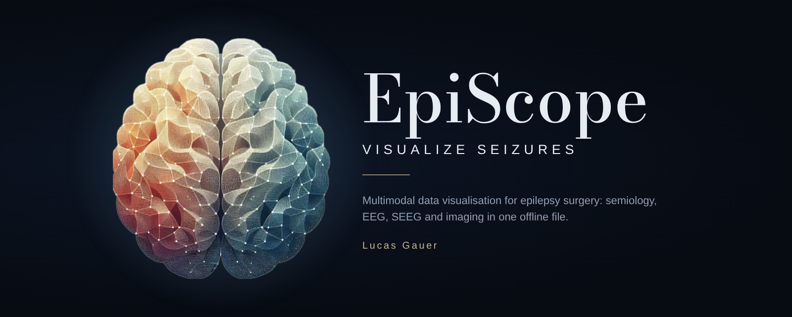

<p align="center"></p>

<p align="center"><b>A multimodal data visualisation workbench for epilepsy surgery.</b><br>
Seizure semiology · scalp EEG · SEEG · imaging · patient record — in one offline HTML file.</p>

<p align="center"><a href="https://github.com/gauerlucas/EpiScope/releases/latest"><b>⬇ Download EpiScope.html</b></a> · <a href="CHANGELOG.md">Changelog</a> · <a href="CITATION.cff">Cite</a> · <a href="LICENSE">MIT licence</a></p>

---

EpiScope brings together, in one place, what a presurgical team needs to discuss a patient: seizure semiology, scalp EEG, SEEG, imaging and the patient's clinical history.

## What it is for

- **See the seizure unfold.** Enter the signs in the order they occur; EpiScope shows which brain regions are plausibly activated over time, on the VEP atlas or on the patient's own anatomy, with lateralisation and network hypotheses.
- **Follow the patient through the surgical pathway.** One record from the history to follow-up: phase 1 video-EEG, multidisciplinary meetings, SEEG, surgery, outcome (Engel, ILAE).
- **Combine the modalities.** MRI, CT and PET registered and segmented in the browser, real electrode contacts located on the CT, scalp EEG (spikes, source imaging, sleep stages) and SEEG (planning, seizures, quantification, stimulation, thermocoagulation) on the same 3D brain.
- **Prepare and present the meeting.** Staff slides, printable reports, annotated captures.

## Principles

- **One HTML file, fully offline.** Open `EpiScope.html` in Edge or Chrome: no installation, no server, no account. No data leaves the computer.
- **Records stay with you.** Patient records are saved in a folder of your choice (a network share works) or in the browser, and can be exported as `.episcope` files.
- **Research prototype.** Not a medical device (no CE mark) and not validated for clinical use. Results support discussion and must be checked against the original data.

## Documentation

Everything else is in the built-in help: press **?** or **F1** in the app for a ten-minute quick start and one chapter per step of the pathway. The manual (French and English) is also available offline in [`docs/manuel/`](docs/manuel/). The interface switches to English in ⋯ › *Language*.

## Build from source

```
python3 tools/build.py        # writes dist/EpiScope.html
```

Details (manual, tests, translations) are in the help and in `tools/`.

## Licence and credits

Code under the [MIT licence](LICENSE). Embedded components keep their own licences; the SpikeNet weights are CC BY-NC 4.0, so `EpiScope.html` cannot be used commercially. The legal notice (⋯ › *Legal notice*) and *Credits and sources* in the app list the licences and the original papers of the published methods EpiScope re-implements: please cite them when you use the corresponding results.

Gauer L. EpiScope — Visualize seizures, version 1.0.0 [software]. 2026. ORCID 0000-0001-8250-1455.
